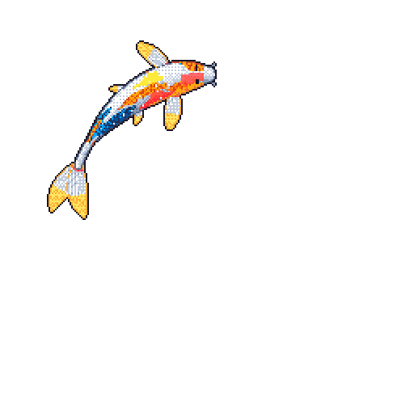

<!-- Every card is an animated SVG drawn by scripts/render_readme_cards.py and refreshed daily
     by .github/workflows/update-profile-art.yml. Design: "Three Worlds".
     Spacing is baked into the SVGs, so keep this block free of blank lines and keep the cards in
     a row on one line with no spaces between them. -->

<a href="https://medium.com/@neuraldev"><picture><source media="(prefers-color-scheme: dark)" srcset="./cards/hero-dark.svg" /></picture></a> 
<picture><source media="(prefers-color-scheme: dark)" srcset="./cards/heatmap-dark.svg" /></picture> 
<picture><source media="(prefers-color-scheme: dark)" srcset="./cards/activity-dark.svg" /></picture> 
 
 
<picture><source media="(prefers-color-scheme: dark)" srcset="./cards/title-coding-dark.svg" /></picture> 
<!-- REPOS:START -->
<a href="https://github.com/UdaySharmaGitHub/UdaySharmaGitHub"><picture><source media="(prefers-color-scheme: dark)" srcset="./cards/repo-1-dark.svg" /></picture></a><a href="https://github.com/UdaySharmaGitHub/CLIC-Agentic-CLI-like-Code-Claude"><picture><source media="(prefers-color-scheme: dark)" srcset="./cards/repo-2-dark.svg" /></picture></a><a href="https://github.com/UdaySharmaGitHub/Rebuilding-Instagram-algorithm"><picture><source media="(prefers-color-scheme: dark)" srcset="./cards/repo-3-dark.svg" /></picture></a>
<!-- REPOS:END -->

  &nbsp;
  &nbsp;
  &nbsp;
  &nbsp;
  &nbsp;
  &nbsp;
  

<picture>
  <source media="(prefers-color-scheme: dark)" srcset="./koi/koi.gif" />
  <source media="(prefers-color-scheme: light)" srcset="./koi/koi.gif" />
  
</picture>
 
<i>Every contribution leaves a ripple.</i>

